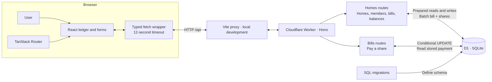
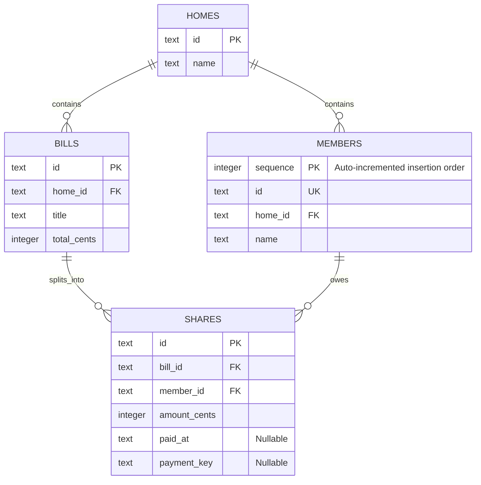
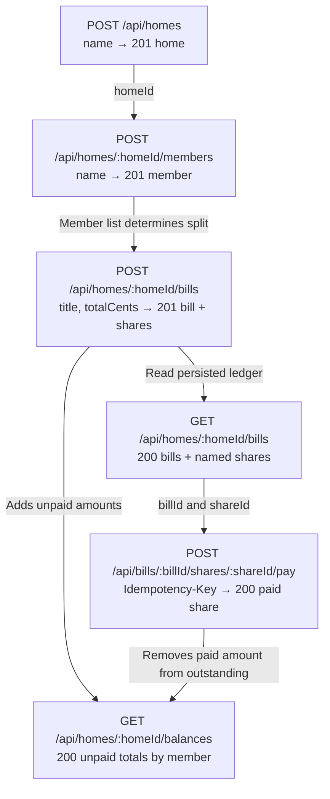
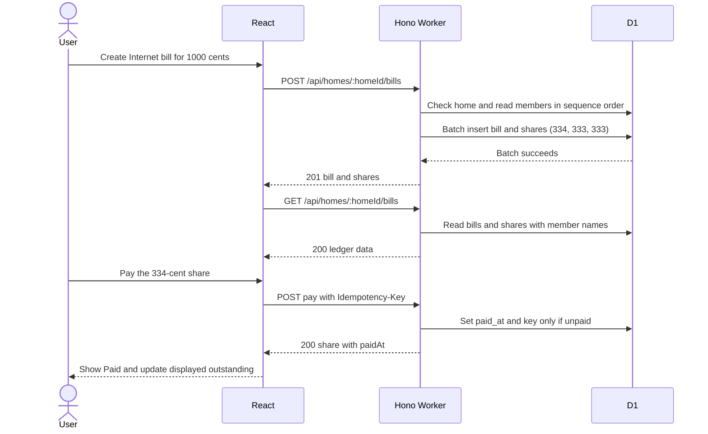

# Fairshare architecture and API walkthrough

## 1. Complete system architecture

The browser renders the ledger and sends HTTP requests. The Vite proxy forwards local requests to Hono on the Worker. Hono validates input and uses the DB binding to access D1. D1 stores the ledger and payment state.

## 2. Database schema

| Named constraint | What it prevents |
|---|---|
| shares_bill_fk and shares_member_fk | A share referencing a missing bill or member |
| shares_one_per_member | Two shares for the same bill and member |
| bills_positive_total | A total that is noninteger, nonpositive, or above the safe integer limit |
| shares_nonnegative_amount | A share with fractional or negative cents, or an amount above the safe integer limit. Zero-cent shares are allowed. |
| shares_valid_payment_state | A paid timestamp without a key, a key without a timestamp, or a blank stored key |

A share joins one bill and one member. The unique constraint keeps that pair from being duplicated. The member sequence determines who gets the extra cents, and the payment timestamp and key are either both present or both absent.

## 3. API map

The arrows show dependencies between operations. The balances endpoint is a separate read. The React ledger calculates its displayed totals from the fetched bill shares.

### Request, response, and edge cases

Names and titles in the examples are strings. IDs are generated UUIDs. The IDs below are placeholders.

| Endpoint | Request | Success response example | Edge cases |
|---|---|---|---|
| POST /api/homes | JSON `{"name":"Maple House"}` | 201 `{"id":"h1","name":"Maple House"}` | 400 malformed JSON, 422 missing or blank name. Duplicate names are allowed by the final schema. |
| POST /api/homes/:homeId/members | JSON `{"name":"Asha"}` | 201 `{"id":"m1","homeId":"h1","name":"Asha"}` | 400 malformed JSON, 422 missing or blank name, 404 home missing |
| POST /api/homes/:homeId/bills | JSON `{"title":"Internet","totalCents":1000}` | 201 bill with `id`, `homeId`, `title`, `totalCents`, and `shares` | 404 home missing, 400 malformed JSON or non-object body, 422 invalid title, zero/negative/fractional/unsafe cents, or no members |
| GET /api/homes/:homeId/bills | No body | 200 `{"bills":[...]}`. Each share includes `memberName`. | 404 home missing. Existing home with no bills returns `{"bills":[]}`. |
| POST /api/bills/:billId/shares/:shareId/pay | Header `Idempotency-Key: demo-pay-1`. No body. | 200 `{"id":"s1","memberId":"m1","amountCents":334,"paidAt":"2026-11-12T00:00:00.000Z"}` | 400 missing or blank key, 404 bill/share pair missing, 409 already paid with a different key. A same-key retry returns the original 200 result. |
| GET /api/homes/:homeId/balances | No body | 200 `{"balances":[{"memberId":"m1","name":"Asha","outstandingCents":0}]}` | 404 home missing. Members with nothing unpaid appear with zero, in insertion order. |
| GET /api/homes | No body | 200 `{"homes":[{"id":"h1","name":"Maple House"}]}` | No homes returns an empty array. |
| DELETE /api/homes/:id | No body | 200 `{"message":"Home deleted successfully"}` | 404 home missing, 409 home has members or bills |
| GET /api/health | No body | 200 `{"status":"ok"}` | Checks the Worker route. |
| GET /api/db-health | No body | 200 `{"status":"ok","database":"connected","result":{"count":1}}` | A failed query can surface as a server error. |

A created share has the shape `{"id":"s1","memberId":"m1","amountCents":334,"paidAt":null}`. The assignment requires API errors in the shape `{"error":"message"}`. The current Hono entry point lacks a custom JSON error handler, so explain the implemented statuses without claiming every error body matches that contract.

## What to explain as data flow

Follow **one bill** through a write, a read, and a payment. For each action, name the request, what the Worker checks or changes, and what the browser shows after the response.

The form sends the bill title and 1,000 cents. The Worker validates the request, loads three members in order, and writes the bill and its 334, 333, and 333-cent shares in one batch. The browser reloads the ledger. When I pay the first share, the Worker stores the payment key and timestamp only if the share is unpaid. React shows Paid after the API confirms it. A same-key retry gets the original result. A different key loses the race with 409.

