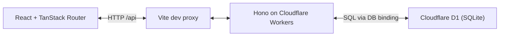

# Fairshare

Fairshare splits household bills into individual shares and tracks who has paid. Create a home, add members, create a bill in whole cents, and mark each share paid from the ledger.

## Run locally

From the repository root:

```sh
pnpm install
pnpm dev
```

Open http://localhost:5173. Vite proxies `/api` requests to Wrangler on port 8787. The backend applies the local D1 migrations before starting.

To isolate backend startup, run `pnpm --filter bill-splitter-api dev`. If Wrangler reports `fetch failed` during migrations, check its network access. If it reports `EPERM` while writing logs, check write access to the log directory shown in the error. Run from a regular terminal if your agent sandbox restricts either. After startup, check `http://localhost:8787/api/db-health` for the local database connection.

## Architecture and data flow



A home owns members and bills. Each share links one bill to one member. The ledger loads bills with member names and share status. When the user clicks Pay, the client sends an idempotency key and updates the displayed status after the API confirms the payment. The balances endpoint sums unpaid shares by member.

## Decisions

1. **Use whole cents and member insertion order.** Integer arithmetic avoids fractional cents. An auto-incrementing member sequence determines who gets the remainder. A 1,000-cent bill for three members splits into 334, 333, and 333 cents.
2. **Write the bill and its shares in one D1 batch.** The batch rolls back if an insert fails. The schema also requires valid foreign keys and at most one share per member per bill.
3. **Store the idempotency key on the share.** A conditional update writes the key and paid timestamp together only while the share is unpaid. A retry with the same key returns the original result. A different key receives 409 after the share is paid. This keeps the write in one row at the cost of a separate payment-attempt history.

## API

| Method | Path | Input or result |
|---|---|---|
| GET | /api/homes | List homes |
| POST | /api/homes | JSON with name |
| DELETE | /api/homes/:id | Delete an empty home |
| POST | /api/homes/:homeId/members | JSON with name |
| GET | /api/homes/:homeId/bills | Bills with shares and member names |
| POST | /api/homes/:homeId/bills | JSON with title and totalCents |
| POST | /api/bills/:billId/shares/:shareId/pay | Idempotency-Key header |
| GET | /api/homes/:homeId/balances | Outstanding cents per member |


## Checks

```sh
pnpm check
pnpm typecheck
pnpm test
pnpm build
```

The Vitest suite runs in the Workers runtime. See the [original assignment](ASSIGNMENT.md) for the full requirements and the [Loom guide](LOOM-GUIDE.md) for the recording script and diagrams.

If Wrangler prints a different **Ready on** port, set the proxy target to that address before starting the frontend. For example, with the backend already running on 8788, use PowerShell in a second terminal:

```powershell
$env:FAIRSHARE_API_URL = 'http://127.0.0.1:8788'
pnpm --filter bill-splitter-web dev
```

See [Architecture and API walkthrough](ARCHITECTURE.md) for the system diagram, database schema, API contracts, and end-to-end recording walkthrough.
